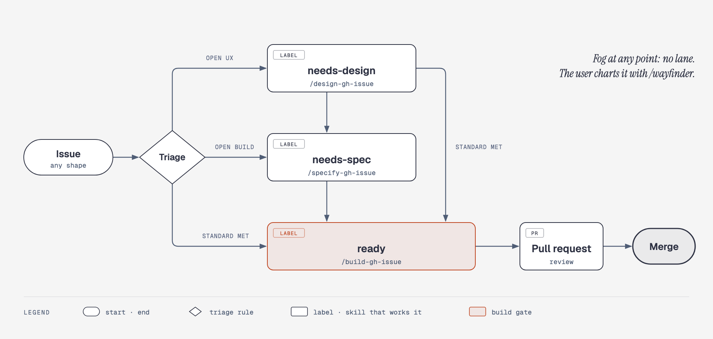
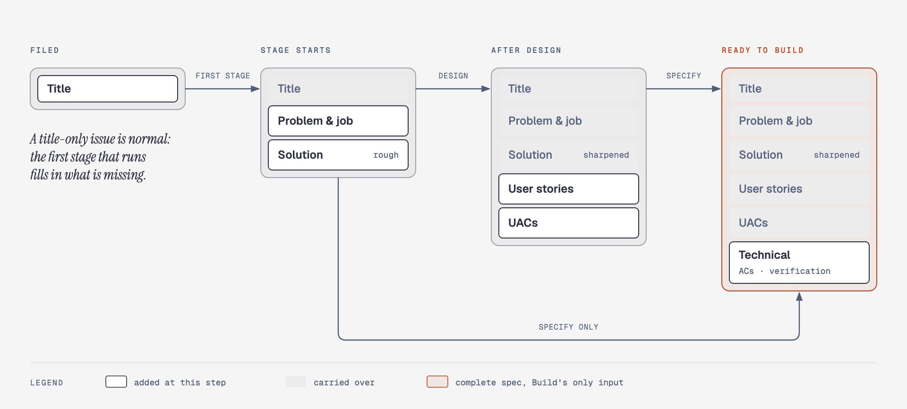

# agent-workflow

Claude Code skills that take a GitHub issue from rough idea to merged PR, with UX design and tech specification as separate, optional stages. The skills hold the method; each project fills in its facts in a tracked **profile** file.

This is the author's working setup, published as is: opinionated, built around Claude Code, GitHub issues and [Orca](https://github.com/stablyai/orca) workers, and used daily on a few personal projects. Take what fits.

## Requirements

- [Claude Code](https://claude.com/claude-code), [`gh`](https://cli.github.com) logged in, `git`, `bash` (3.2 is enough), `jq`, `python3`. macOS is the tested platform.
- [Orca](https://github.com/stablyai/orca) and its `orca` CLI for `/orchestrate-gh-issues` (workers, messages) and the Orca update check. The single-issue skills (`/design-gh-issue`, `/specify-gh-issue`, `/build-gh-issue`) run without it.
- Skills and plugins the skills call but this repo does not ship: the [superpowers](https://github.com/obra/superpowers) plugin, `/code-review` (Claude Code), and optionally `/wayfinder`, `/gh-inbox-dispatcher`, `/ui-canvas`, `harvesting-session-knowledge` and the Impeccable plugin. A step whose tool is missing is skipped or reported, not guessed.

## Install

```sh
git clone https://github.com/jaylouiz/agent-workflow.git
bash agent-workflow/install.sh                 # add --global-rules to also install the author's global CLAUDE.md
```

Links every `skills/*` into `~/.claude/skills/` and this checkout to `~/.claude/agent-workflow` (the skills read `reference/` through it). It also registers a global SessionStart hook (`orca-update-review/check.sh`) in `~/.claude/settings.json` (a backup is kept as `settings.json.bak`): when a newly installed Orca version has not been reviewed against this workflow (`skills/orca-update-review/snapshot/version`), the hook writes an impact report and starts `/orca-update-review` in the first interactive session of the day (`initialUserMessage`); the skill asks before it changes anything. Edit skills in this repo only; rerun after adding, renaming or removing a skill.

`--global-rules` links [global/CLAUDE.md](global/CLAUDE.md) as `~/.claude/CLAUDE.md`: the author's global rules (inbox issues for side findings, `/wayfinder` for vague goals, the friction ledger and retro). Optional; the script never overwrites an existing file.

Per project: copy [reference/project-profile.md](reference/project-profile.md) to `<project>/.claude/issue-workflow.md`, fill it in and commit it. Executable facts (ports, risk globs, verify, after-merge, PR-body checks) go into `<project>/.claude/issue-workflow.sh` from [reference/project-config.sh](reference/project-config.sh), read by the orchestrate scripts.

Cloud sessions (Claude Code on the web) do not get these skills (only the attached repo, no `gh issue`/`gh pr`, no plugins); what works there lives in each project's `CLAUDE.md`.

## Vocabulary

**Two tracks.** **Discovery** decides *what* to build and *how it should work for the user*: cheap, throwaway artefacts, user in the loop. **Delivery** builds it right: production code, tests, review, merge.

**Stages.** Each is optional except Build; an issue enters at the first stage it needs.

| Stage | Track | Question | Skill | Output |
|---|---|---|---|---|
| Chart | Discovery | Which problem, which outcome? Too big for one session. | `/wayfinder` (user-run only) | map of decision tickets |
| Design | Discovery | How should it look and behave for the user? | `/design-gh-issue` | UX decision, user stories, UACs |
| Specify | Delivery | How do we build it, how do we know it is done? | `/specify-gh-issue` | Spec (approach, technical ACs, verification) |
| Build | Delivery | | `/build-gh-issue` | PR |
| Review, Merge | Delivery | Is it correct, can it ship? | `/code-review`, `/orchestrate-gh-issues` | merged PR |

"Design" always means UX design here. Tech design is part of Specify.

**Lanes** are labels that say where an issue waits: `needs-design` → `needs-spec` → `ready`. Hold labels (e.g. `on-hold-after-spec`) stop the pipeline after a stage. A lane names the **next step**; the **phase** says whether work on it has started. Clients such as [Tandem](https://github.com/jaylouiz/tandem) group issues by phase, read in this order (first match wins):

| Phase | Rule | Set by |
|---|---|---|
| Done | issue closed | the merge (`Closes #n`) |
| Inbox | `inbox`, or open with no lane label (fog included) | filing, `/gh-inbox-dispatcher` |
| UX Design | `phase:design` | `/design-gh-issue` at its start; removed at the handover |
| Build | `phase:build`, or an open PR with `Closes #n` | `/specify-gh-issue` or `/build-gh-issue` at its start; kept until close |
| Backlog | a lane label, no `phase:*` | triage, the Design handover |

`ux-impact` marks an issue whose result the user should look at after Done (set in Design's handover and by Build for UI changes); its **Look comment** says where.

| Term | Meaning |
|---|---|
| Triage | Giving an issue its entry lane by the triage rule ([reference/issue-rules.md](reference/issue-rules.md)). |
| Brief | The UX problem statement at the start of Design: job, users, states, constraints, what to keep. |
| Variant | One structurally different answer to the design question (layout, hierarchy, primary affordance). Colour or copy tweaks are not variants. |
| Tech check | Read-only cost and risk rating of the variants during Design. Not a spec. |
| Prototype | Throwaway coded variants inside the real app, switched by `?variant=` and a switcher bar. Lives on a proto branch `proto/<n>-<slug>`, never merged. |
| Sketch | Canvas frames via `/ui-canvas`, when code is too costly or too risky. |
| Round | One cycle of show (screenshots, preview URL) → feedback → revise. |
| UX decision | The `## UX decision` section of the issue body. Ends Design. |
| Job | What the user needs to get done, verb + object, solution-neutral ("Plan the day"); a short list in the profile's "Jobs". Adding one is the user's call. |
| User story | `As <who>, when <situation>, I want <what>, so that <outcome>`: the level under a job where concrete behaviour lives. |
| UAC | User acceptance criterion: behaviour the user can observe. Layers and owners: [reference/issue-rules.md](reference/issue-rules.md). |
| Spec | The issue body after Specify: the issue standard's layers plus approach, technical ACs, implementation notes, verification. The only input Build needs. |
| Profile | The project's tracked file with the facts these skills leave open (`.claude/issue-workflow.md`). |
| Ledger | One line per friction, written the moment it happens (`workflow-retro/ledger.sh`, global CLAUDE.md); outside the work tree, deleted after the retro. |
| Retro | `/workflow-retro` at the end of a run or session: ledgers → causes → the cheapest fix, plus a convergence pass when the instructions grow. |
| One-way / two-way decision | One-way: costly to undo or the user's call by definition (Design round, held merge, the profile's "Decisions" list); only these reach the user. Two-way: everything else; the agent decides, records it and continues. |
| Coordination log | Per-issue Markdown file for agent-to-agent progress (stage starts, milestones, PR link, fix rounds, resume text): `decide.sh log`, at `~/.claude/issue-logs/<owner>/<repo>/<n>.md`, outside the work tree; deleted by `merge-pr.sh after`. The issue thread keeps only what the user reads. |
| Look comment | Build's marked comment (`<!-- decision-note look -->`) on a `ux-impact` issue: preview URL seeded to show the change, `Path:` for production, final screenshots, what to check. |
| Comment markers | Every agent comment starts with `<!-- decision-<kind> … -->` so it never reads as the user's. A comment without a marker is the user's and belongs to the decision it names (a first line `D<k>:` with a request or record `D<k>` earlier in the thread), else to the nearest earlier marked comment (a note included: a reply to a note belongs to no decision and is ignored, in Tandem and in `decide.sh` alike). Request and record footers tell the user to start a reply with `D<k>:` to reach an older decision. Decision kinds carry an id (`request D<k>`, `record`, `answer`, `resolved`, `followup`); note kinds are typed for clients: `note round R<k>` (design round; screenshot alt `R<k> · <variant> · <desktop\|mobile>`), `note options` (Specify approaches), `note look`, plain `note` (summary). |
| Comment cap | Every agent comment stays scannable: at most 1500 visible characters, no line over 400; detail goes into `<details>` (`decide.sh check`, enforced by the guard hook). |
| Decision request | A one-way question as a marked issue comment (`decide.sh request`) plus label `needs-decision`. The user answers in a comment, any time. |
| Parked | An issue waiting on a decision request. Its worker has ended; a fresh one resumes after the answer. |
| Agent decision | A two-way decision recorded in the body's `## Decisions` and a marked comment, label `agent-decided`. Never blocks; removing the label accepts it, a comment asks for a change. |
| Push | [Tandem](https://github.com/jaylouiz/tandem) telling the coordinator that Feedback arrived or a Card should start: `orca orchestration send --to run:<id> --type status --subject "tandem push: <owner/repo>#<n> <feedback\|start>"` to the newest Run whose coordinator terminal is live in that repo; with no Run it launches `/orchestrate-gh-issues #<n>`. The coordinator handles it in its message read (orchestrate section 6). |
| Digest | The coordinator's one bundled ping of all open decision requests: when the run goes idle, or when the oldest unannounced one passes the profile's cap. |
| Running log | The project's committed watch list of recurring causes and the context-size history (path in the profile's "Retro"). Never loaded into a session. |

## Issue standard and triage rule

What an issue holds at each stage (`## Problem` solution-free, `## Solution` sharpened per stage, job, user stories, UACs) and how it gets its lane (fog, `needs-design`, `needs-spec`, `ready`): [reference/issue-rules.md](reference/issue-rules.md), the file the skills load.

<picture>
  <source media="(prefers-color-scheme: dark)" srcset="docs/diagrams/lanes-dark.png">
  
</picture>

<picture>
  <source media="(prefers-color-scheme: dark)" srcset="docs/diagrams/issue-standard-dark.png">
  
</picture>

Diagram sources: `docs/diagrams/render.py` (writes the HTML; rasterize with the diagram-design skill's `export_png.py`).

## Generic vs project

- **Skill**: a method, a step order, a tool-agnostic rule.
- **Profile** (or the project's `CLAUDE.md`): anything that names the project's files, commands, labels, URLs, tools, invariants or quirks. Facts already in `CLAUDE.md` are referenced from the profile, not copied.

When a skill says "the profile's X", read that section of `.claude/issue-workflow.md`. A missing section means the step does not apply to this project; say so in the report instead of guessing.

## Background

Separating discovery from delivery follows Marty Cagan's dual-track product work; bounded, rough shaping before building follows Basecamp's *Shape Up*; disposable prototypes follow Brooks ("plan to throw one away"). Scaling ceremony to risk (a small issue goes straight to `ready`) follows Birgitta Böckeler's critique of heavy spec-driven tooling on martinfowler.com, and Anthropic's *Building effective agents* advice to prefer simple, explicit workflows.

## History and license

This repository starts with a single public commit; issue and PR numbers up to #49 in skills, docs and comments refer to the author's private archive of the earlier history.

MIT, see [LICENSE](LICENSE). Third-party material: [NOTICE](NOTICE).
