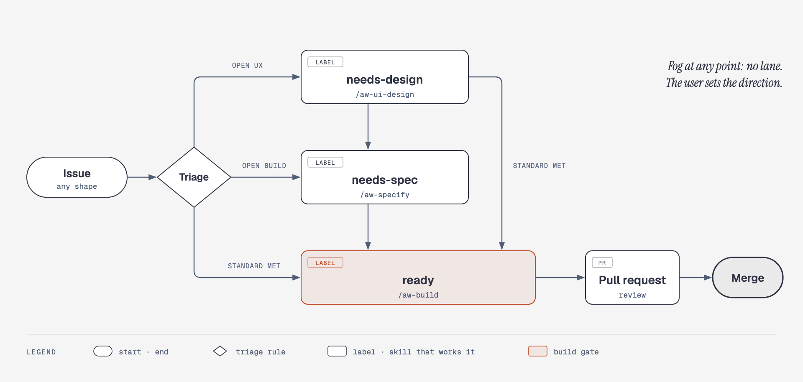
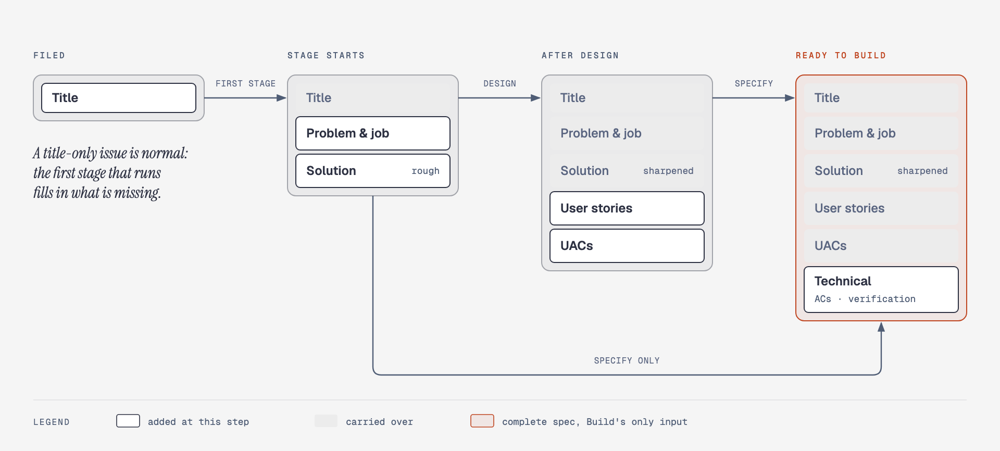

# Vocabulary

The words the skills, the issues and the agents' comments use. The [README](../README.md) has the short glossary and the
setup; what a board client may rely on is the [board client contract](contract.md).

## Tracks, stages and lanes

**Two tracks.** **Discovery** decides *what* to build and *how it should work for the user*: cheap, throwaway artefacts, user in the loop. **Delivery** builds it right: production code, tests, review, merge.

**Stages.** Each is optional except Build; an issue enters at the first stage it needs.

| Stage | Track | Question | Skill | Output |
|---|---|---|---|---|
| Chart | Discovery | Which problem, which outcome? Too big for one session. | the user, by any method (no skill here) | a direction the stages can take |
| Design | Discovery | How should it look and behave for the user? | `/aw-ui-design` | UX decision, user stories, UACs |
| Specify | Delivery | How do we build it, how do we know it is done? | `/aw-specify` | Spec (approach, technical ACs, verification) |
| Build | Delivery | | `/aw-build` | PR |
| Review, Merge | Delivery | Is it correct, can it ship? | `/code-review`, `/aw-coordinate` | merged PR |

"Design" always means UX design here. Tech design is part of Specify.

**Lanes** are labels that say where an issue waits: `needs-design` → `needs-spec` → `ready`. Hold labels (e.g. `on-hold-after-spec`) stop the pipeline after a stage; `on-hold` stops every stage start and the merge. A lane names the **next step**; the **phase** says whether work on it has started. Clients such as [Tandem](https://github.com/jaylouiz/tandem) group issues by phase: the table of phases, and how GitHub's native issue status and the `phase:*` labels carry them, moved to the board client contract, [docs/contract.md "Phases and statuses"](contract.md#phases).

`ux-impact` marks an issue whose result the user should look at after Done (set in Design's handover and by Build for UI changes); its **Look comment** says where.

## Terms

| Term | Meaning |
|---|---|
| Triage | Giving an issue its entry lane by the triage rule ([reference/issue-rules.md](../reference/issue-rules.md)). |
| Brief | The UX problem statement at the start of Design: job, users, states, constraints, what to keep. |
| Variant | One structurally different answer to the design question (layout, hierarchy, primary affordance). Colour or copy tweaks are not variants. |
| Tech check | Read-only cost and risk rating of the variants during Design. Not a spec. |
| Prototype | Throwaway coded variants inside the real app, switched by `?variant=` and a switcher bar. Lives on a proto branch `proto/<n>-<slug>`, never merged. |
| Sketch | Canvas frames via `/ui-canvas`, when code is too costly or too risky. |
| Round | One cycle of show (screenshots, preview URL) → feedback → revise. Its comment is the overview of the decision: one section per question with an option table and the screenshot under it. |
| UX decision | The `## UX decision` section of the issue body. Ends Design. |
| Job | What the user needs to get done, verb + object, solution-neutral ("Plan the day"); a short list in the profile's "Jobs". Adding one is the user's call. |
| User story | `As <who>, when <situation>, I want <what>, so that <outcome>`: the level under a job where concrete behaviour lives. |
| UAC | User acceptance criterion: behaviour the user can observe. Layers and owners: [reference/issue-rules.md](../reference/issue-rules.md). |
| Spec | The issue body after Specify: the issue standard's layers plus approach, technical ACs, implementation notes, verification. The only input Build needs. |
| Profile | The project's tracked file with the facts these skills leave open (`.claude/issue-workflow.md`), written by `/aw-setup`. |
| Ledger | One line per friction, written the moment it happens (`aw-retro/ledger.sh`, global CLAUDE.md); outside the work tree, archived by the retro (`ledger.sh close`). |
| Retro | `/aw-retro` at the end of a run or session: ledgers → causes → the cheapest fix, plus a convergence pass when the instructions grow. |
| One-way / two-way decision | One-way: costly to undo or the user's call by definition (Design round, held merge, the profile's "Decisions" list); only these reach the user. Two-way: everything else; the agent decides, records it and continues. |
| Coordination log | Per-issue Markdown file for agent-to-agent progress (stage starts, milestones, PR link, fix rounds, resume text): `decide.sh log`, at `~/.claude/issue-logs/<owner>/<repo>/<n>.md`, outside the work tree; deleted by `merge-pr.sh after`. The issue thread keeps only what the user reads. Path and line format: [docs/contract.md](contract.md#coordination-log). |
| Look comment | Build's marked comment (`<!-- decision-note look -->`) on a `ux-impact` issue: preview URL seeded to show the change, `Path:` for production, final screenshots, what to check. |
| Comment markers | Every agent comment starts with `<!-- decision-<kind> … -->` so it never reads as the user's; a comment without a marker is the user's. The kinds, and which decision a reply belongs to, moved to the board client contract: [docs/contract.md "Comment markers"](contract.md#comment-markers). |
| Comment cap | Every agent comment stays scannable: at most 1500 visible characters, no line over 400; detail goes into `
` (`decide.sh check`, enforced by the guard hook). |
| Decision request | A one-way question as a marked issue comment (`decide.sh request`) plus label `needs-decision`: numbered questions, lettered options (`★` = recommended), a link to the overview that explains them and a prefilled answer to copy. The user answers in a comment, any time: `ok`, the copied block, `1B 2A` or free text. Format: [docs/decision-format.md](decision-format.md). |
| Parked | An issue waiting on a decision request. Its worker has ended; a fresh one resumes after the answer. |
| Agent decision | A two-way decision recorded in the body's `## Decisions` and a marked comment, label `agent-decided`. Never blocks; removing the label accepts it, a comment asks for a change. |
| Coordinator, worker | `/aw-coordinate`: the session that screens a hand-off, starts one worker per stage, routes the review, merges and reports ([reference/coordination.md](../reference/coordination.md)). A worker runs one stage and never merges: an Orca worker, or in **subagent mode** (no Orca) a Claude Code background subagent in a git worktree of its own. |
| Push | [Tandem](https://github.com/jaylouiz/tandem) telling the coordinator that Feedback arrived or a Card should start: `orca orchestration send --to run:<id> --type status --subject "tandem push: <owner/repo>#<n> <feedback\|start>"` to the newest Run whose coordinator terminal is live in that repo; with no Run it launches `/aw-coordinate #<n>`. The coordinator handles it in its message read (coordinate section 6). |
| Digest | The coordinator's one bundled ping of all open decision requests: when the run goes idle, or when the oldest unannounced one passes `WF_DIGEST_CAP`. |
| Running log | The project's committed watch list of recurring causes and the context-size history (path in the profile's "Retro"). Never loaded into a session. |

## Issue standard and triage rule

What an issue holds at each stage (`## Problem` solution-free, `## Solution` sharpened per stage, job, user stories, UACs) and how it gets its lane (fog, `needs-design`, `needs-spec`, `ready`): [reference/issue-rules.md](../reference/issue-rules.md), the file the skills load.

<picture>
  <source media="(prefers-color-scheme: dark)" srcset="diagrams/lanes-dark.png">
  
</picture>

<picture>
  <source media="(prefers-color-scheme: dark)" srcset="diagrams/issue-standard-dark.png">
  
</picture>

Diagram sources: `docs/diagrams/render.py` (writes the HTML; rasterize with the diagram-design skill's `export_png.py`).

## Generic vs project

- **Skill**: a method, a step order, a tool-agnostic rule.
- **Profile** (or the project's `CLAUDE.md`): anything that names the project's files, commands, labels, URLs, tools, invariants or quirks. Facts already in `CLAUDE.md` are referenced from the profile, not copied.

When a skill says "the profile's X", read that section of `.claude/issue-workflow.md`. A missing section means the step does not apply to this project; say so in the report instead of guessing. A repo without a profile works the same way (every section missing); the skills point to `/aw-setup` once.

## Background

Separating discovery from delivery follows Marty Cagan's dual-track product work; bounded, rough shaping before building follows Basecamp's *Shape Up*; disposable prototypes follow Brooks ("plan to throw one away"). Scaling ceremony to risk (a small issue goes straight to `ready`) follows Birgitta Böckeler's critique of heavy spec-driven tooling on martinfowler.com, and Anthropic's *Building effective agents* advice to prefer simple, explicit workflows.
